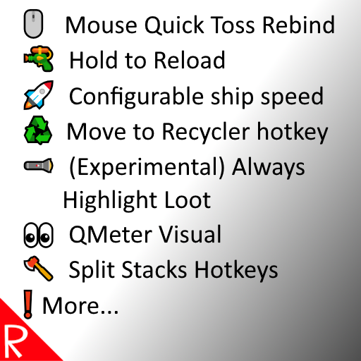

# Quasimorph Red's Optional Modifications Mod

This is a collection of modifications.  Each change is individually enabled and by default all items are disabled.
# Recent Additions
* Call Capsule Button - Show Capsule usage count.
* Quick Move to Fridge 

# Docs
Due to Steam having a limit on a mod's description, the feature details and images can be found at https://github.com/NBKRedSpy/RedsOptionalTweaks/blob/main/README.md
Below is a quick summary.

# Modifications Overview
Below is a list of functionality in mod.  

By default, each individual piece of functionality has to be enabled by the user in the Mods -> Red's Optional Tweaks screen.
This allows the user to choose only the changes they want.

| Type | Name | Description |
| :--- | :--- | :--- |
| Balance | Ship Speed Boost | Increase the speed of ship travel. |
| QoL | Always Highlight Loot | Always highlights look when in a raid.  Similar to always holding the alt key.|
| QoL | Faster Elevator | Speed up changing levels by increasing the animation speed.|
| QoL | Hold Reload|Can hold the reload key to keep reloading when waiting and moving.  Useful for single load weapons|
| QoL | Mouse Quick Toss Rebind | Change the key bind for what the game calls "Fast Toss". By default the game uses the Control key to move items between storage panes. |
| QoL | QMeter Visual| When in a raid, changes the QMorphos state name to yellow when above 800. This matches the music intensity change in the game at this level.|
| QoL | Recycle and Fridge Hotkey | Hold R when hovering over an item to quick move it to the recycler.  Hold F to move to the refrigerator.|
| QoL | Repeat Production Order | Quickly repeat the previous order in the production queue by right clicking or holding shift and clicking. See the [Repeat Production Order](#repeat-production-order) section.|
| QoL | Show Capsule Amount | During a raid, shows the amount of Capsules are currently available on the "Call Capsule" button.|
| QoL | Show Durability Delta | Changes the breakable items tooltip to include the missing durability and the missing max durability from previous repairs.|
| QoL | Show Experience Maxed | Adds an asterisk to the Experience Item gain tooltip if the merc has the perk, but is already at the max level
| Qol | Show Mercenary Class Out Of Date | Highlights mercs that have a class which does not match the latest perks for that class. Ex: Changed a perk and the mercenary still has the old version.|
| QoL | Split Stacks Hotkeys | Adds hotkeys for amount presets and adds "increase" and "decrease" hotkeys. |
| QoL | Stack Total Inventory Count| When holding the alt key, the count on stacks will show the total amount of that item owned. This is identical to the number that is shown in the item's tooltip|

 🧪 More items in the future...

## Maximum Compatibility
Each modification works like its own mini-mod. Disable one, and it's as if it was never there.  This is useful for working around bugs or handling conflicts with other mods.
See the [Compatibility - Technical](#compatibility---technical) section for details.

# Enjoying the Mods?
If you enjoy my mods and want to buy me a coffee, check out my [Ko-Fi](https://ko-fi.com/nbkredspy71915) page.
Thanks!

# Source Code
Source code is available on GitHub at https://github.com/NBKRedSpy/RedsOptionalTweaks

# Changes
See the https://github.com/NBKRedSpy/RedsOptionalTweaks/blob/main/CHANGELOG.md for the list of changes.

# Search Tags
Highlight loot, recycle hotkey, ctrl move, quick move, quick toss, queue, faster ship speed, shorter travel time, binding, ROMP.
# Credits
* Special thanks to Crynano for his excellent Mod Configuration Menu.
* The TF2 RedSpy icon is from the reddit user [iwilding](https://www.reddit.com/user/iwilding/) from the post found [here](https://www.reddit.com/r/tf2/comments/2384j5/i_drew_a_red_spy/)
* The Ship Speed Boost is based on Steam user [critic](https://steamcommunity.com/id/cybercritic)'s mod [Ship Speed Boost](https://steamcommunity.com/sharedfiles/filedetails/?id=3548633074).  The functionality is replicated with permission.
* TF2 Font is from [fontriver](https://www.fontriver.com/font/tf2_build/)
* Animated gif conversion via https://ezgif.com/video-to-gif
